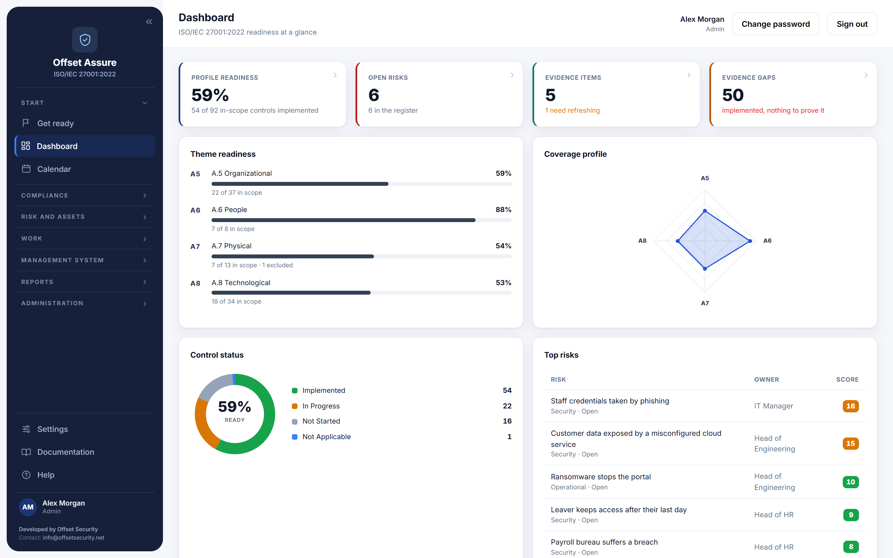
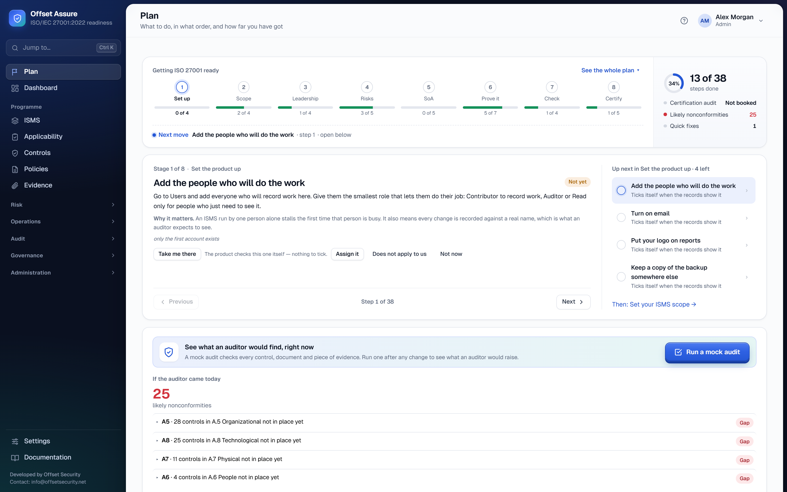
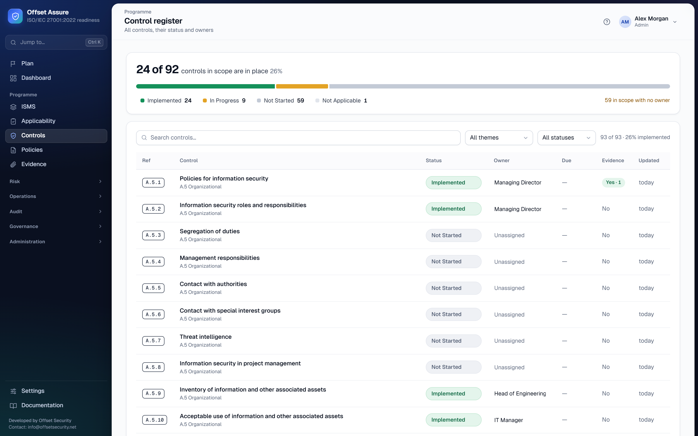
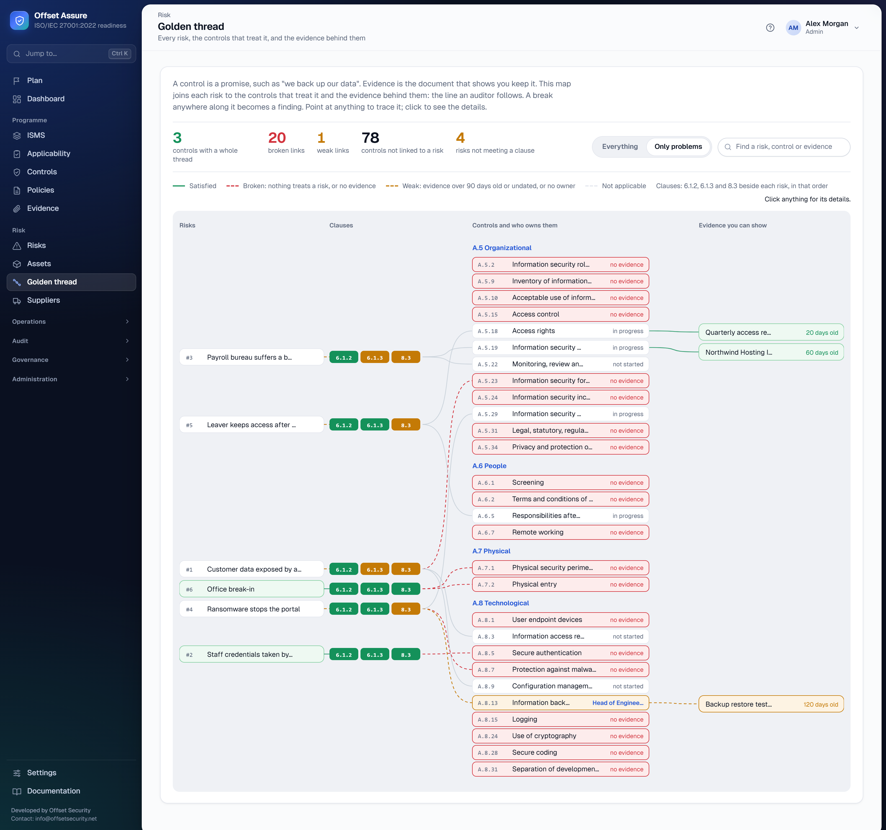
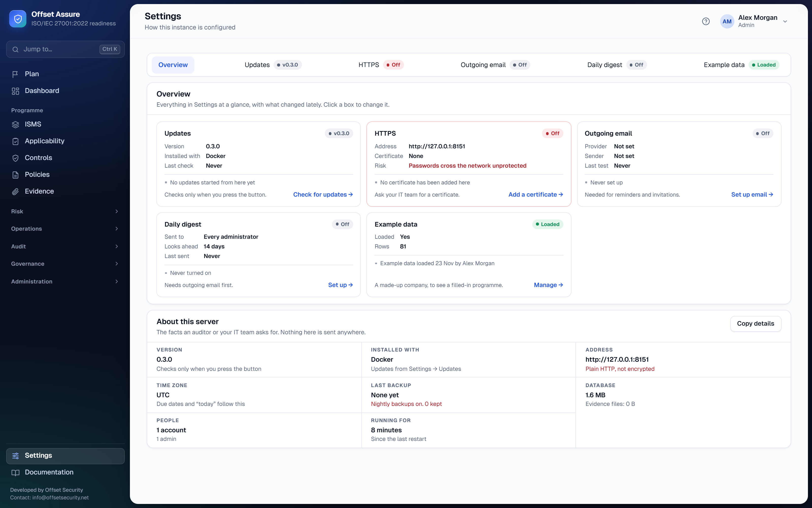

# Offset Assure

[](https://railway.com/deploy/offset-assure)

**ISO/IEC 27001:2022** compliance software that runs on your own server. No cloud
account, no per-seat pricing, and nothing leaves the machine you install it on.

This repository is the whole product: the application, the framework content,
and everything needed to build the installers. Nothing is fetched from
anywhere else.

Statement of Applicability, the management-system registers, control testing, document templates, example data, and a Plan that follows clauses 4 to 10 to a certification audit.

Every Offset product has HTTPS, backups and restore from the screen, an audit
trail, reminder emails, signed one-click updates, and a Forgot password flow
for administrators.

> Offset Assure is not affiliated with, endorsed by, or certified by
> ISO.











<sub>Screenshots from the current release, filled with the built-in example data. The people and the company are made up.</sub>

## Try it online

Click **Deploy on Railway** above to get your own copy running online in a few minutes. No terminal and no settings to fill in.

1. Click the button and sign in to Railway, for example with your GitHub account.
2. Click **Deploy** and wait two or three minutes.
3. Open the web address Railway shows and create the first administrator account.

Railway is a paid hosting service with a free trial. On the free plan the copy sleeps when no one is using it, and stops if the monthly free credit runs out. For real use, install it on your own server from the downloads below.

## Download it

**[Releases](../../releases)** — take the newest one.

| | |
|---|---|
| Windows | `OffsetAssure-<version>-setup.exe`. It carries its own Node, so the machine needs nothing else |
| Linux | `offset-assure-<version>-linux-x64.tar.gz`, then `sudo ./install.sh assure` |
| Docker | `docker pull ghcr.io/offsetsecurity/offset-assure` |

On Docker, pull the updater beside it so an administrator can install updates
from Settings:

```bash
docker pull ghcr.io/offsetsecurity/offset-assure
docker pull ghcr.io/offsetsecurity/offset-assure-updater
```

Then copy `deploy/docker/env.example` to `.env`, fill in the two secrets it
asks for, and run `docker compose up -d`.

[INSTALL.md](INSTALL.md) covers installing properly: HTTPS, backups, ports and
what to do when something goes wrong. [docs/user-guide.md](docs/user-guide.md)
covers using it.

## What a customer gets

| | |
|---|---|
| Windows | An installer that carries its own Node. No prerequisites |
| Linux | A tarball installed as systemd services |
| Docker | `ghcr.io/offsetsecurity/offset-assure` |

An installed copy checks that same Releases page for updates, and an
administrator installs them from Settings.

## Working on it

```bash
corepack enable                 # pnpm ships with Node 24
pnpm install
cp .env.example .env            # fill in SESSION_SECRET and FIELD_ENC_KEY
pnpm migrate                    # creates the schema, a SQLite file
pnpm dev                        # http://localhost:8080
```

No database to install. `pnpm test` runs the suite; the end-to-end half needs
`E2E_DATABASE_URL` pointed at a throwaway file.

### Layout

```
apps/api/       the API, worker and updater
apps/web/       the screens
packs/assure/   the framework: 93 Annex A controls, their explanations,
                Plan, the sample library and the help pages
deploy/         Dockerfile, compose, the Windows and Linux builds, releasing
docs/           what it is, how it works, how to install it
```

**The framework content is data, not code.** `packs/assure/pack.json` decides
which screens appear, so changing the wording of a requirement never means
touching the application.

## Releasing

Push a version tag and GitHub builds the Windows installer, the Linux bundle
and the images, signs one manifest naming all of them, and publishes it to
its own Releases page:

```bash
git tag -a v0.2.0 -m "What changed, in a sentence or two"
git push origin v0.2.0
```

See [docs/dev/releasing.md](docs/dev/releasing.md) for the one-time setup, and
what to do when a release goes wrong.

## Licence

Free and open source, under the [Apache License 2.0](LICENSE).

---

**Offset Security** — Offset Risk. Enable Growth.
